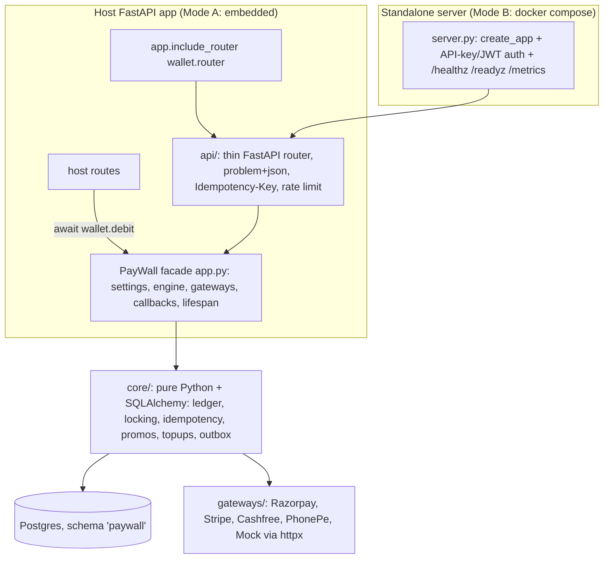
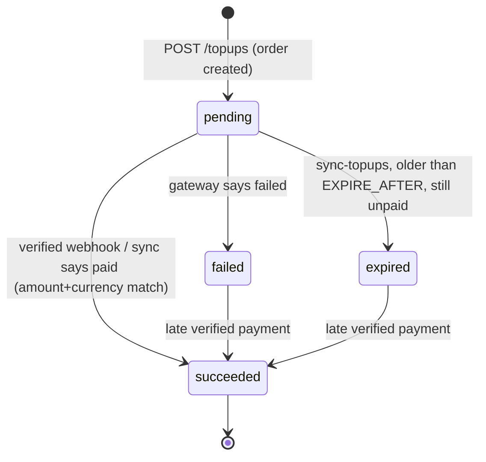

# PayWall — Implementation Plan (Step 1)

## Context

You want a **reusable Python package** that gives any app a closed-loop, in-app wallet with payment-gateway top-ups. The goal is that app developers stop rewriting wallet + payment-gateway code for every project, without giving up correctness or security. It is also your flagship fintech portfolio project, so every design choice must be explainable in an interview.

The repo is empty (only `.claude/` skills). Your answers so far:
- **Scope:** the full spec, each piece built in its simplest working form. **Nothing dummy:** no stubs, no TODOs and no fake data in library code. Every feature is real, reachable and tested.
- **Name:** `paywall` (free on PyPI; `walletkit` is taken by a 2013 package). Import `paywall`, class `PayWall`, CLI `paywall`, env prefix `PAYWALL_`, default DB schema `paywall`.
- **Database:** PostgreSQL 18 already runs natively (Windows service `postgresql-x64-18`). Docker and Redis are **not** installed.

Environment facts: `uv 0.12.5` and Python 3.14 are installed, and uv will fetch 3.12. The `gh` CLI is present. There is no git remote and no commits yet; the branch is `master`.

---

## 1. Architecture overview

Three layers. Only the bottom one knows about money rules.



- **core/** takes an `AsyncSession` plus plain arguments and returns plain dataclasses. It never imports FastAPI. mypy runs in strict mode.
- **PayWall facade** owns the engine and the gateways. It runs each core operation inside `run_tx()`, which is one transaction with bounded deadlock/serialization retry. It exposes the Python API and `.router`.
- **api/** is one router used by both modes. Auth is injected as a dependency that returns a `Principal`:
  - **Embedded:** the host passes `auth=` (its own user → `Principal(user_id, role)`). There is no insecure default: building the router without `auth` raises an error.
  - **Standalone:** `server.py` supplies an auth dependency that accepts an API key (`pw_…`) or a JWT.
- **Errors work without host cooperation.** The router uses a custom `APIRoute` class that turns `PayWallError` and validation errors into `application/problem+json`, so the host doesn't need to register exception handlers.
- **One lifespan** (`wallet.lifespan`) runs background loops: outbox dispatch, `sync-topups` and idempotency cleanup. The host uses `FastAPI(lifespan=wallet.lifespan)`, and the standalone server uses the same lifespan.
- **The closed loop is enforced by absence.** There is no payout, withdrawal or bank-transfer code anywhere, and money settles in the app owner's gateway account. Transfers stay off by default, and the README warns that enabling them with real money needs legal review.
- **Multi-tenancy later** means adding `tenant_id` to `accounts`, `promo_codes` and `api_keys` and to every unique key. Nothing in the design blocks that, and it is not built.

## 2. Folder / module structure

```
PayWall/
├─ pyproject.toml  uv.lock  .python-version(3.12)  README.md  LICENSE(MIT)  .env.example  .gitignore
├─ .pre-commit-config.yaml   .github/workflows/ci.yml   Dockerfile   docker-compose.yml
├─ src/paywall/
│  ├─ __init__.py        # PayWall, Settings, Principal, PayWallError, ErrorCode
│  ├─ py.typed
│  ├─ app.py             # PayWall facade: from_env(), router, lifespan, Python API, on_* callbacks
│  ├─ config.py          # Settings (pydantic-settings, SecretStr for every secret)
│  ├─ errors.py          # ErrorCode enum → HTTP status + title
│  ├─ observability.py   # JSON log formatter, request_id contextvar, Prometheus metrics
│  ├─ ratelimit.py       # fixed-window limiter: memory backend + optional Redis backend
│  ├─ cli.py             # Typer: migrate, reconcile, sync-topups, cleanup, api-keys, serve
│  ├─ server.py          # standalone create_app(): auth, CORS, health, metrics
│  ├─ db/
│  │  ├─ models.py       # SQLAlchemy 2.0 tables
│  │  ├─ session.py      # engine, sessionmaker, run_tx(fn) with jittered retry
│  │  └─ migrations/     # bundled Alembic env.py + versions/
│  ├─ core/              # framework-agnostic money logic
│  │  ├─ ledger.py       # post_entry(), lock_wallets(), system_account()
│  │  ├─ idempotency.py  # claim(), replay-or-422, store()
│  │  ├─ wallets.py      # get_or_create, history (cursor), freeze/unfreeze
│  │  ├─ payments.py     # debit, refund, transfer, adjust, reverse
│  │  ├─ limits.py       # per-txn / max balance / daily limits
│  │  ├─ promos.py       # create, redeem, deactivate, stats
│  │  ├─ topups.py       # create_topup, settle_topup, sync_topups
│  │  ├─ outbox.py       # emit(), dispatcher, signed outgoing webhooks
│  │  ├─ audit.py  apikeys.py  reconcile.py
│  ├─ gateways/          # base.py (Protocol + dataclasses), mock.py, razorpay.py, stripe.py, cashfree.py, phonepe.py, __init__.py (registry)
│  └─ api/               # router.py (ProblemRoute), deps.py, schemas.py, wallets.py, topups.py, promos.py, transfers.py, webhooks.py, admin.py
├─ tests/                # conftest.py (real Postgres), core/, api/, gateways/, fixtures/
├─ examples/demo_shop/   # Phase 7
├─ loadtest/             # locustfile.py, seed.py
└─ docs/  architecture.md  benchmarks.md  decisions/000N-*.md  superpowers/specs/ (this plan)
```

## 3. Database schema (all in schema `PAYWALL_DB_SCHEMA`, default `paywall`)

Notation: `uuid` primary keys for anything exposed in the API, so ids can't be guessed or enumerated. `bigint identity` for append-heavy internal tables. All timestamps are `timestamptz default now()`.

| Table | Columns | Constraints / indexes and why |
|---|---|---|
| **accounts** | id uuid, kind text, external_user_id text?, gateway text?, currency char(3), balance bigint?, status text, created_at, updated_at | `kind IN (USER_WALLET, GATEWAY_CLEARING, PROMO_EXPENSE, APP_REVENUE, ADJUSTMENTS)`. **`(kind='USER_WALLET') = (balance IS NOT NULL)`**: only user wallets cache a balance (see §4). `CHECK (balance >= 0)` is the last defense against negative wallets. Partial unique `(external_user_id, currency) WHERE kind='USER_WALLET'` gives one wallet per user. Unique `NULLS NOT DISTINCT (kind, gateway, currency) WHERE kind<>'USER_WALLET'` gives one system account of each kind. `currency ~ '^[A-Z]{3}$'`. `status IN (active, frozen)`. |
| **journal_entries** | id uuid, type text, reference text, currency, metadata jsonb, actor text, reverses_entry_id uuid? FK, request_id text?, created_at | `type IN (TOPUP, PROMO, DEBIT, REFUND, TRANSFER, ADJUSTMENT, REVERSAL)`. Partial unique `(reverses_entry_id) WHERE type='REVERSAL'`: an entry can be reversed at most once. Index `(reverses_entry_id)` to sum refunds. Index `(reference)` for lookups. |
| **postings** | id bigint identity, entry_id FK, account_id FK, amount bigint, created_at | `CHECK (amount <> 0)`. Index `(account_id, id DESC)` serves history pagination and daily-limit sums. |
| **idempotency_keys** | scope text, key text, fingerprint char(64), status text, response_code int, response_body jsonb, created_at, expires_at | PK `(scope, key)`: keys are scoped per caller. Index `(expires_at)` for cleanup. Status is always written as `completed`; see §5 for why "in progress" lives in an advisory lock. |
| **topup_intents** | id uuid, account_id FK, gateway, amount bigint, currency, status, gateway_order_id, gateway_payment_id?, entry_id? FK, failure_reason?, metadata, created_at, updated_at | `amount > 0`. `status IN (pending, succeeded, failed, expired)`. **Unique `(gateway, gateway_payment_id)`** means one payment can never be credited twice. Unique `(gateway, gateway_order_id)`. Index `(status, created_at)` for sync. |
| **webhook_events** | id bigint, gateway, gateway_event_id, event_type, payload jsonb (redacted), received_at | **Unique `(gateway, gateway_event_id)`** gives replay dedupe. Only signature-verified events are stored, so attackers can't fill the table. |
| **promo_codes** | id uuid, code text, amount, currency, max_total_redemptions int?, max_per_user int=1, budget_cap bigint?, redeemed_count int, redeemed_amount bigint, valid_from, valid_until, active bool, allowed_user_ids text[]?, metadata, created_by, created_at | Unique `code` with `CHECK (code = upper(code))` makes codes case-insensitive without an extension. `CHECK (redeemed_count <= max_total_redemptions)` and `CHECK (redeemed_amount <= budget_cap)` are DB-level last defense against over-redemption. |
| **promo_redemptions** | id bigint, promo_id FK, account_id FK, entry_id FK, created_at | Index `(promo_id, account_id)` for the per-user count, which runs under the promo row lock. |
| **api_keys** | id uuid, name, prefix text unique, key_hash char(64) unique, scopes text[], created_at, revoked_at? | Only the SHA-256 hash is stored. Keys are 32 random bytes, and that high entropy means a fast hash is safe and allows O(1) lookup. bcrypt is meant for low-entropy passwords. Scopes are a subset of `{wallet:read, wallet:write, admin}`. |
| **audit_log** | id bigint, actor, action, target_type, target_id, details jsonb, request_id, created_at | Append-only. Index `(target_type, target_id)`. |
| **outbox_events** | id bigint, event_type, payload jsonb, request_id, created_at, attempts int, next_attempt_at, delivered_at?, last_error? | Partial index `(next_attempt_at) WHERE delivered_at IS NULL` for the dispatcher. |

**DB triggers (one migration, about 30 lines of SQL):**
1. `BEFORE UPDATE OR DELETE` on `journal_entries`, `postings` and `audit_log` raises an exception. This enforces ledger immutability even against buggy code or a `psql` session.
2. A `DEFERRABLE INITIALLY DEFERRED` constraint trigger on `postings` checks at commit that each entry has at least 2 postings and `SUM(amount) = 0`. Unbalanced entries can't commit even if the app code has a bug.

## 4. Ledger design

- **Sign convention:** `posting.amount > 0` increases that account's balance and `< 0` decreases it. Each entry sums to 0, so **the sum of all postings in the system is always 0**. This is the invariant behind reconcile and the property test.
- **Only `USER_WALLET` caches `balance`.** System accounts such as `APP_REVENUE` are touched by every debit. Caching their balance would make every debit in the system queue on one row (a hot-row bottleneck). Their balance is computed with `SUM(postings)` when needed (reconcile, admin stats).
- `post_entry(session, type, reference, postings, actor, metadata, reverses=None)` is the **only** writer of ledger rows. It validates the sum and the currency, inserts the entry and postings, does `UPDATE accounts SET balance = balance + :delta` for wallet postings, and emits outbox events.

Worked example (₹ amounts; stored in paise):

| Operation | Postings |
|---|---|
| Top-up ₹500 via Razorpay | `GATEWAY_CLEARING[razorpay] −50000`, `USER_WALLET[u1] +50000` |
| Promo WELCOME50 | `PROMO_EXPENSE −5000`, `USER_WALLET[u1] +5000` |
| Debit ₹499 (order_789) | `USER_WALLET[u1] −49900`, `APP_REVENUE +49900` |
| Refund ₹200 of that debit | `APP_REVENUE −20000`, `USER_WALLET[u1] +20000` (`reverses_entry_id` = the debit) |
| Transfer ₹100 u1→u2 | `USER_WALLET[u1] −10000`, `USER_WALLET[u2] +10000` |
| Admin adjustment +₹10 | `ADJUSTMENTS −1000`, `USER_WALLET[u1] +1000` |
| Reversal of entry X | exact negation of X's postings, `reverses_entry_id = X` |

## 5. Concurrency and idempotency

**Every mutating operation is one `run_tx()` transaction (READ COMMITTED):**
1. idempotency claim;
2. `SELECT … FOR UPDATE` on rows, in a fixed order: **promo / topup-intent row, then wallets sorted by id**;
3. validate rules and limits;
4. `post_entry`, which updates cached balances and emits to the outbox;
5. store the idempotency response;
6. COMMIT.

`run_tx` retries on SQLSTATE `40P01` (deadlock) and `40001` (serialization failure): at most 3 attempts, with sleeps of `base·2ⁿ·random()`. A retry is safe because the rollback undid everything.

**Why pessimistic locking:**

| Option | Behaviour under contention | Verdict |
|---|---|---|
| Optimistic (version column) | Losers fail and retry, which wastes work. With 100 debits on one wallet, most retry repeatedly. | Good for rare conflicts, bad for hot wallets. |
| SERIALIZABLE | Correct, but any transaction can abort. Every code path needs retry, predicate locks cause false-positive aborts, and performance is hard to predict. | More magic, harder to explain. |
| **`FOR UPDATE` (chosen)** | Contention is per wallet only. Waiters queue instead of failing. Simple to reason about. | Costs: blocked waits and deadlock risk. Mitigations: deterministic lock order, short transactions, no wallet lock held during gateway HTTP calls, plus retry. |

**Idempotency, a deliberate change from the spec:** the spec's `in_progress` row can't coexist with "commit in the same transaction". Other transactions can't see an uncommitted row, and a row written in its own transaction gets stuck as `in_progress` forever if the process crashes. So "in progress" is a **transaction-scoped advisory lock**, which Postgres releases automatically on commit, rollback or crash:

```
BEGIN
  pg_try_advisory_xact_lock(int8 from sha256(scope|key))   → false ⇒ 409 IDEMPOTENCY_KEY_IN_PROGRESS
  SELECT idempotency_keys (scope,key, not expired)
     same fingerprint ⇒ return stored response (header Idempotent-Replayed: true), no execution
     different fingerprint ⇒ 422 IDEMPOTENCY_KEY_REUSED
  …do the work…
  INSERT idempotency_keys(status='completed', response) ON CONFLICT (expired row) DO UPDATE
COMMIT
```

- Only successful results are stored. A business failure such as `INSUFFICIENT_FUNDS` rolls back, so retrying with the same key re-evaluates (nothing happened the first time).
- The fingerprint is `sha256(method + path + canonical JSON body)` for HTTP, and `sha256(operation + canonical args)` for the Python API.
- Scope is `apikey:<prefix>`, `user:<id>`, or `app` for Python API calls.

**Double-spend (test 1):**
```mermaid
sequenceDiagram
  participant A as Debit A ₹10
  participant B as Debit B ₹10
  participant DB as Postgres (wallet balance ₹10)
  A->>DB: BEGIN; SELECT wallet FOR UPDATE
  B->>DB: BEGIN; SELECT wallet FOR UPDATE
  Note over B,DB: B waits on A's row lock
  A->>DB: balance 10 ≥ 10 → postings, balance=0, idem row, COMMIT
  DB-->>B: lock granted, reads balance 0
  B->>DB: 0 < 10 → ROLLBACK
  B-->>B: 422 INSUFFICIENT_FUNDS
```

**Webhook replay (test 4):**
```mermaid
sequenceDiagram
  participant G as Gateway (5 deliveries)
  participant W as POST /v1/webhooks/razorpay
  participant DB as Postgres
  G->>W: delivery 1 (evt_1)
  W->>W: HMAC(raw body) ok, parse
  W->>DB: BEGIN; INSERT webhook_events(evt_1) ok; intent FOR UPDATE (pending); wallet FOR UPDATE; post TOPUP; intent=succeeded; COMMIT
  W-->>G: 200
  G->>W: deliveries 2..5 (even concurrently)
  W->>DB: INSERT webhook_events(evt_1) → conflict (waits for delivery 1, then conflicts)
  W-->>G: 200 duplicate, no credit
  Note over W,DB: A different event for the same payment sees intent=succeeded → no-op. unique(gateway, payment_id) is the last defense.
```

## 6. Gateways and top-up state machine

```python
class PaymentGateway(Protocol):
    name: str
    async def create_order(self, topup: TopupIntent) -> CheckoutSession: ...   # gateway_order_id, redirect_url | None, client_data dict
    async def verify_webhook(self, headers: Mapping[str, str], raw_body: bytes) -> GatewayEvent: ...  # raises InvalidSignature
    async def fetch_payment_status(self, gateway_order_id: str) -> PaymentStatus: ...  # paid | failed | pending, payment_id, amount, currency
```

**Adapters use `httpx.AsyncClient` plus stdlib `hmac` instead of the official SDKs.** This is a change from the spec, and I'm asking for your OK as part of approving this plan. Reasons:
- The Razorpay, Cashfree and PhonePe SDKs are synchronous and would block the async event loop.
- PhonePe's SDK is published on its own package index, not PyPI, so a PyPI package can't depend on it.
- Each adapter is only about 2 REST calls plus 1 HMAC check, around 80 lines.
- Fewer dependencies means a smaller supply-chain surface for `pip-audit`.

**Before writing each adapter I check the gateway's current docs** (spec rule): endpoints, signature scheme and amount units. Known pitfall: Cashfree sends amounts in rupees as decimals, so they are converted via `Decimal` → paise.

| Gateway | Checkout data returned | Webhook auth |
|---|---|---|
| Razorpay | `key_id`, `order_id` (opened by Checkout.js) | HMAC-SHA256 of the body. Dedupe via the `X-Razorpay-Event-Id` header. |
| Stripe | Checkout Session `url` | `Stripe-Signature` with `t=` and a 5-minute tolerance |
| Cashfree | `payment_session_id` | HMAC over timestamp + body, with tolerance |
| PhonePe | redirect URL | per current docs (verified in Phase 4) |
| Mock | local `/v1/mock/pay/{order_id}` | Same Stripe-style signed webhook through the **same** settle path. Off by default, and **startup refuses it when `PAYWALL_ENV=production`**. |



- **Late success after `failed` or `expired` is allowed** (also a change from the spec). Otherwise a user whose payment captured late pays and gets nothing.
- An amount or currency mismatch never credits: it logs, increments a metric and returns 200, so the gateway doesn't retry forever.
- `settle_topup()` is shared by the webhook and `sync-topups`. Settlement credits even a frozen wallet, because the money was really received; an admin can reverse it. Creating a top-up on a frozen wallet is blocked.
- `create_topup` calls the gateway inside the transaction. It holds no wallet lock and has a 10 s timeout. If the call fails, the transaction rolls back and the client retries with the same key.
- Stored payloads are redacted recursively: `card`, `vpa`, `upi`, `bank`, `email`, `contact`, `phone`, `*secret*` and `*token*` are removed.

## 7. API (all under `/v1`; the host chooses the mount prefix)

| Method / path | Who | Notes |
|---|---|---|
| GET `/v1/wallets/me` | user, `wallet:read` | Lazily creates the wallet. |
| GET `/v1/wallets/me/transactions?cursor&limit&type&from&to` | user, `wallet:read` | Opaque cursor = last posting id. |
| POST `/v1/wallets/me/debits` | user, `wallet:write` | `{amount, reference, metadata}` |
| POST `/v1/debits/{entry_id}/refunds` | admin, `wallet:write` key | Users can't refund themselves. |
| POST `/v1/topups` · GET `/v1/topups/{id}` | user (owner) | `{amount, gateway}` |
| POST `/v1/promos/redeem` | user | Stricter rate limit. |
| POST `/v1/transfers` | user | 403 `TRANSFERS_DISABLED` unless the flag is on. Recipient must exist (404). |
| POST `/v1/webhooks/{gateway}` | signature only | |
| POST `/v1/mock/pay/{order_id}` | mock enabled only | |
| GET `/v1/admin/wallets/{user_id}` · POST `…/freeze` · `…/unfreeze` | admin | audit-logged |
| POST `/v1/admin/adjustments` · POST `/v1/admin/entries/{id}/reversal` | admin | Mandatory `reason`. Audit-logged. |
| POST/GET `/v1/admin/promos` · POST `…/{id}/deactivate` · GET `…/{id}/stats` | admin | audit-logged |
| POST/GET/DELETE `/v1/admin/api-keys` · POST `/v1/auth/tokens` | admin (standalone only) | Key shown once. The token endpoint mints a short-lived user JWT. |
| GET `/healthz` `/readyz` `/metrics` | public (standalone) | `/readyz` runs `SELECT 1`. |

- **Every POST except webhooks and mock-pay requires `Idempotency-Key`** (400 `IDEMPOTENCY_KEY_MISSING`).
- **Standalone API-key callers** name the end user with `X-User-Id`, so `me` means that user.

Examples:
```http
POST /v1/wallets/me/debits   Idempotency-Key: order_789_pay
{"amount": 49900, "reference": "order_789", "metadata": {"sku": "TSHIRT-M"}}
→ 201 {"entry_id":"6f1c…","type":"DEBIT","amount":49900,"currency":"INR","balance_after":50100,"reference":"order_789","created_at":"…"}

POST /v1/topups   Idempotency-Key: k1   {"amount": 50000, "gateway": "razorpay"}
→ 201 {"id":"9a2e…","status":"pending","gateway":"razorpay","checkout":{"order_id":"order_Nx…","key_id":"rzp_test_…","amount":50000,"currency":"INR"}}

→ 422 application/problem+json
{"type":"urn:paywall:error:insufficient_funds","title":"Insufficient funds","status":422,
 "detail":"Balance 1000 < amount 49900","code":"INSUFFICIENT_FUNDS","request_id":"req_…"}
```

**Error codes:**

| Status | Codes |
|---|---|
| 400 | `IDEMPOTENCY_KEY_MISSING`, `GATEWAY_NOT_ENABLED`, `INVALID_SIGNATURE` |
| 401 | `UNAUTHORIZED` |
| 403 | `FORBIDDEN`, `TRANSFERS_DISABLED`, `PROMO_NOT_ELIGIBLE` |
| 404 | `NOT_FOUND`, `WALLET_NOT_FOUND`, `PROMO_NOT_FOUND` |
| 409 | `IDEMPOTENCY_KEY_IN_PROGRESS`, `PROMO_EXHAUSTED`, `PROMO_ALREADY_REDEEMED`, `WALLET_FROZEN` |
| 422 | `VALIDATION_ERROR`, `INSUFFICIENT_FUNDS`, `IDEMPOTENCY_KEY_REUSED`, `AMOUNT_OUT_OF_RANGE`, `LIMIT_EXCEEDED`, `MAX_BALANCE_EXCEEDED`, `REFUND_EXCEEDS_DEBIT`, `PROMO_NOT_ACTIVE` |
| 429 | `RATE_LIMITED` |
| 502 | `GATEWAY_ERROR` |

**Python API** (all `async`; each mutation takes `idempotency_key` and returns a frozen dataclass):
- `PayWall.from_env(auth=...)` and `.router` / `.lifespan`
- Wallet operations: `get_wallet`, `history`, `debit`, `refund`, `create_topup`, `redeem_promo`, `transfer`
- Admin operations: `adjust`, `reverse`
- Event hooks: `on(event_type)` plus `on_credit` / `on_debit` / `on_topup_succeeded`

## 8. Configuration reference (prefix `PAYWALL_`; secrets are `SecretStr`, never logged)

| Group | Variables (default) |
|---|---|
| Core | `DATABASE_URL` (required, `postgresql+asyncpg://…`), `DB_SCHEMA`=paywall, `DB_POOL_SIZE`=10, `DB_MAX_OVERFLOW`=10, `DB_POOL_TIMEOUT`=10, `ENV`=development, `DEFAULT_CURRENCY`=INR, `TX_MAX_RETRIES`=3, `IDEMPOTENCY_TTL_HOURS`=24, `LOG_LEVEL`=INFO, `LOG_JSON`=true, `BACKGROUND_JOBS`=true |
| Limits (paise) | `MIN_AMOUNT`=100, `MAX_AMOUNT`=1000000, `MAX_BALANCE`=1000000, `DAILY_DEBIT_LIMIT`=2000000, `LIMITS_TIMEZONE`=Asia/Kolkata |
| Transfers | `ENABLE_TRANSFERS`=false, `TRANSFER_MAX_AMOUNT`=500000, `DAILY_TRANSFER_LIMIT`=1000000 |
| Top-ups | `TOPUP_SYNC_AFTER_MINUTES`=5, `TOPUP_EXPIRE_AFTER_MINUTES`=60, `WEBHOOK_TOLERANCE_SECONDS`=300 |
| Razorpay | `RAZORPAY_ENABLED`, `RAZORPAY_KEY_ID`, `RAZORPAY_KEY_SECRET`, `RAZORPAY_WEBHOOK_SECRET` |
| Stripe | `STRIPE_ENABLED`, `STRIPE_SECRET_KEY`, `STRIPE_WEBHOOK_SECRET`, `STRIPE_SUCCESS_URL`, `STRIPE_CANCEL_URL` |
| Cashfree | `CASHFREE_ENABLED`, `CASHFREE_APP_ID`, `CASHFREE_SECRET_KEY`, `CASHFREE_ENVIRONMENT`=sandbox, `CASHFREE_RETURN_URL` |
| PhonePe | `PHONEPE_ENABLED`, `PHONEPE_CLIENT_ID`, `PHONEPE_CLIENT_SECRET`, `PHONEPE_CLIENT_VERSION`, `PHONEPE_ENVIRONMENT`=sandbox, `PHONEPE_REDIRECT_URL`, plus webhook credentials (names finalized against the docs in Phase 4) |
| Mock | `MOCK_GATEWAY_ENABLED`=false, `MOCK_WEBHOOK_SECRET` |
| Events | `EVENTS_WEBHOOK_URL`, `EVENTS_WEBHOOK_SECRET`, `EVENTS_MAX_ATTEMPTS`=10 |
| Standalone | `JWT_SECRET` (unset means JWT disabled), `JWT_TTL_MINUTES`=60, `CORS_ORIGINS`=[] |
| Rate limit | `REDIS_URL` (unset means in-memory), `RATE_LIMIT_PER_MINUTE`=120, `PROMO_RATE_LIMIT_PER_MINUTE`=10 |
| Dev only | `TEST_DATABASE_URL` |

Packaging: core dependencies are `fastapi`, `pydantic-settings`, `sqlalchemy[asyncio]`, `asyncpg`, `alembic`, `httpx`, `typer` and `prometheus-client`. Extras: `paywall[server]` (uvicorn, pyjwt) and `paywall[redis]`.

## 9. Testing strategy

- **Real Postgres, no testcontainers**, because there's no Docker locally. `conftest.py` creates a throwaway database `paywall_test_<uuid>` on `PAYWALL_TEST_DATABASE_URL` (your PG 18), runs `alembic upgrade head` through the real `migrate` code path, and drops the database at session end. Tests isolate themselves with unique user ids and promo codes, because concurrency tests need committed data and so can't use rollback-per-test.
- **CI** runs the same suite on a GitHub Actions `postgres:16` and `redis:7` service, so we cover both PG 16 and 18.

| Spec test | File | Assertion |
|---|---|---|
| 1 Double-spend | tests/core/test_concurrency.py | 100 concurrent ₹10 debits on ₹100: exactly 10 succeed, balance = 0, reconcile clean |
| 2 Transfer deadlock | tests/core/test_transfers.py | A→B and B→A loops with `gather`: no deadlock error escapes, A+B total unchanged |
| 3 Idempotency race | tests/core/test_idempotency.py | 20 concurrent calls with the same key: 1 ledger entry; the rest replay the same body or get 409; different body gives 422 |
| 4 Webhook replay | tests/api/test_webhooks.py | The same signed payload 5× (sequential and concurrent): exactly 1 credit |
| 5 Promo over-redeem | tests/core/test_promos.py | 500 concurrent redemptions with limit 100: exactly 100 succeed and `redeemed_count = 100` |
| 6 Ledger invariant | tests/core/test_invariants.py | Hypothesis drives random operation sequences: each entry sums to 0, cached balance = SUM(postings), global sum = 0 |
| 7 Refunds | tests/core/test_refunds.py | Partial plus concurrent refunds never exceed the original |
| 8 Gateways | tests/gateways/test_*.py | Valid, tampered and stale signatures against documented sample payloads (HMAC computed with a test secret). `respx` mocks the REST calls. |

Also: immutability triggers reject UPDATE/DELETE, the deferred trigger rejects unbalanced entries, and API tests cover the auth matrix and problem+json format.

Coverage gates: `--cov-fail-under=90` on `paywall`, and a 100% target on `core/ledger.py`, `payments.py`, `topups.py` and `promos.py`, reviewed at each phase end.

**Load test:** Locust (pure Python, no extra install). `paywall serve --workers 4` against local PG 18, 1000 pre-funded users (seeded via admin adjustments), and a mix of balance reads and debits. RPS and p50/p95/p99 come from Locust's CSV. `docs/benchmarks.md` records hardware, versions and the exact commands, so anyone can reproduce it, including with `docker compose`.

## 10. Phases (each ends with: tests + ruff + mypy green → summary → 2–4 interview concepts → stop for your go-ahead)

How I work each phase:
- At the start, I write a task-level plan with the **writing-plans** skill. In Phase 0 I commit this design as `docs/superpowers/specs/2026-10-11-paywall-design.md`.
- I build with **test-driven-development**, plus the **fastapi** skill from Phase 2 onward.
- I use **systematic-debugging** on any failure.
- Before claiming a phase is done, I run **verification-before-completion** and then **/code-review**. I add **/security-review** in Phases 4 and 6.
- I commit small, conventional commits (`feat:`, `test:`, …).
- I work inline in this session, without subagents.

Estimates assume full-time days for an intermediate developer.

| # | Deliverable | Done when | Est. |
|---|---|---|---|
| 0 | Scaffold: rename branch to `main`; uv project (src layout, py.typed, extras); ruff, mypy strict, pre-commit, bandit, pip-audit; CI workflow; Dockerfile and compose (Postgres 16 + Redis + app); `.env.example`; settings skeleton; test DB fixture | One test passes locally against PG 18. CI is green after you approve creating a GitHub repo. | 1 d |
| 1 | `db/models`, initial migration + triggers, `migrate` CLI, `run_tx` retry, `ledger`, `idempotency`, `wallets`, `debit`, `adjust`, `reverse`, outbox `emit`, facade Python API. ADRs 1–4. | Tests 1, 3 and 6 pass | 4–5 d |
| 2 | API router (ProblemRoute, deps, schemas, OpenAPI examples), embedded `auth=`, `server.py` with API keys (CLI + admin endpoints) and JWT (`/auth/tokens`), request-id JSON logging, a minimal sample host app in tests | Every endpoint is documented and tested. The sample host mounts the router. | 3–4 d |
| 3 | Promo codes (create, redeem, deactivate, stats), admin wallet endpoints (freeze, adjust, reversal), audit log | Test 5 passes | 2 d |
| 4 | Gateway protocol and registry, MockGateway, then Razorpay → Stripe → Cashfree → PhonePe (docs checked first), webhooks, `settle_topup`, `sync-topups`, redaction | Test 4 passes. Sandbox top-up works for each gateway (via `sync-topups` polling, or a tunnel for webhooks). | 5–7 d |
| 5 | Refunds, transfers behind the flag, limits, outbox dispatcher with callbacks and signed outgoing webhooks plus backoff, `reconcile` CLI | Tests 2 and 7 pass. Reconcile reports clean after the full suite. | 3–4 d |
| 6 | Rate limiting (memory and Redis), Prometheus metrics (latency, ops by type/result, lock wait, webhook failures), health checks, CORS, graceful shutdown, bandit and pip-audit clean, load test | `docs/benchmarks.md` has real numbers | 3 d |
| 7 | Demo shop (`examples/demo_shop`, FastAPI and one HTML page: top up, promo, buy, history), README 10-minute quickstart for both modes, `docs/architecture.md` with Mermaid diagrams, ADRs completed, TestPyPI publish | You can follow the README from a clean venv | 3 d |

**Total:** about 24–30 working days.

## 11. Risks, open questions, changes from the spec

**Changes I'm making (approving this plan approves them):**
1. **Idempotency "in progress" uses an advisory lock, not a status row** (§5). The spec's version can't satisfy both "same transaction" and "409 while running", and its stored `in_progress` row gets stuck after a crash.
2. **No cached balance on system accounts**, to avoid the hot row (§4).
3. **httpx instead of the official gateway SDKs** (§6).
4. **Native Postgres instead of testcontainers, and the load test runs natively instead of in Docker.** This is forced by having no Docker here. Compose is still shipped and smoke-tested in CI.
5. **Late `failed`/`expired` → `succeeded` is allowed.** Settling a top-up credits a frozen wallet. Refunds are admin or `wallet:write` only and are allowed on frozen wallets, since they are reversals. A transfer recipient must already have a wallet.
6. **JWT "login" means `POST /v1/auth/tokens`,** where a backend uses its admin API key to mint a user token. Building a password store would add attack surface for a demo.
7. **The outbox is at-least-once.** Host callbacks and webhook consumers must dedupe on `event_id`. Ordering is not guaranteed across workers.

**Risks:**
- **User-facing `POST /wallets/me/debits`** lets a user spend on any `reference` the host never created. That only costs the user their own money, but the README will recommend that hosts debit from their backend (Python API or API key) and confirm orders through `on_debit`.
- **Stripe** restricts onboarding of new Indian businesses. Test mode works; live use may not. I'll verify in Phase 4.
- **Sandbox end-to-end needs real sandbox accounts** for all 4 gateways, plus a tunnel (cloudflared or ngrok) if we want real webhooks; otherwise polling via `sync-topups` covers it.
- **Daily limits are computed from postings under the wallet lock.** That is correct, but cost grows with daily activity per user. It's fine at this scale and documented as a known trade-off.

**Open questions (not blocking; I'll ask when the phase needs them):**
- **Phase 0:** your local Postgres credentials, for `PAYWALL_TEST_DATABASE_URL` in a git-ignored `.env`. Also, may I create a **private** GitHub repo with `gh repo create` and push, so CI can run?
- **Phase 4:** do you have, or can you create, sandbox accounts for Razorpay, Stripe, Cashfree and PhonePe?
- **Phase 7:** your TestPyPI account and token.

## Verification (end to end)

- `uv run ruff check . && uv run ruff format --check . && uv run mypy src && uv run pytest` must pass at every phase end.
- `uv run paywall migrate` then `uv run paywall reconcile` must exit 0 (clean) on the test database after the suite.
- Phase 2+: start `uv run paywall serve`, then open `/docs` and exercise an API key → debit → history flow with httpx/curl.
- Phase 4: run a sandbox top-up per gateway, then confirm the balance and reconcile.
- Phase 6: run Locust headless; the numbers go into `docs/benchmarks.md`.
- CI: lint, mypy, tests on PG 16 + Redis, bandit, pip-audit, Docker build plus `compose up --wait` + `curl /readyz`.
